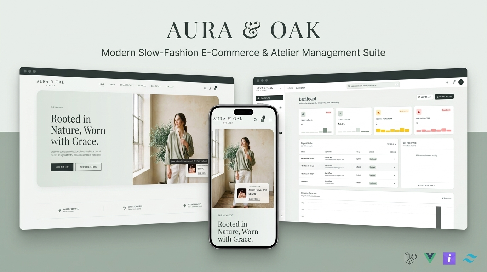
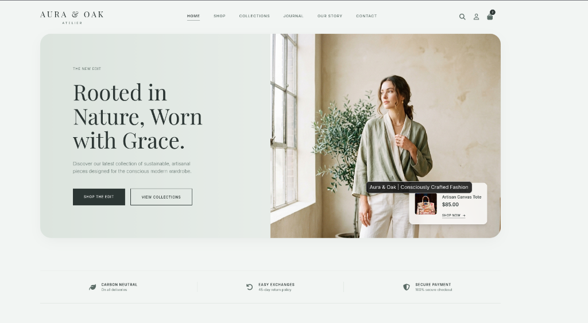
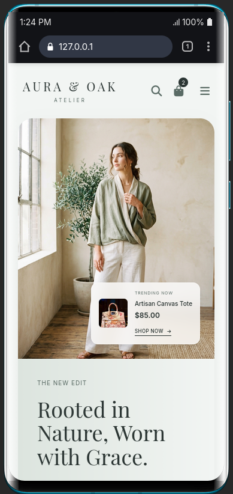
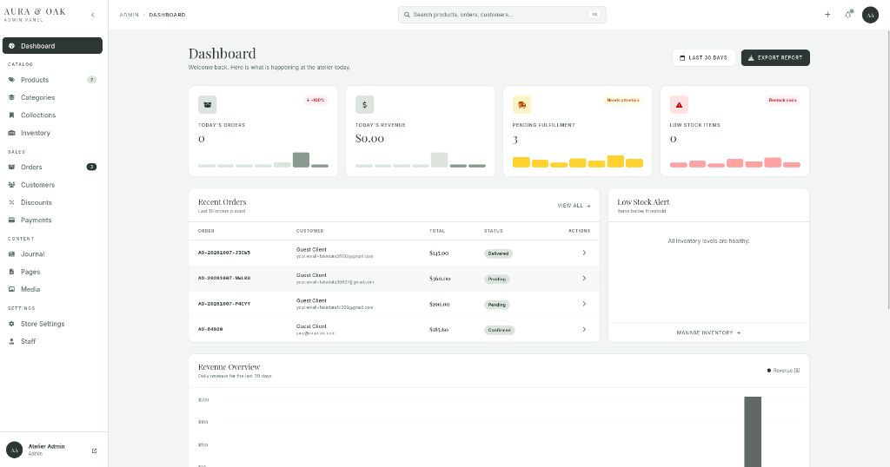

<p align="center">
  
</p>

<p align="center">
  <strong>A modern, conscious luxury fashion e-commerce storefront and atelier operational management suite.</strong>
</p>

<p align="center">
  
  
  
  
  
  
  
</p>

---

## ✦ Overview

**Aura & Oak** is an artisanal, slow-fashion e-commerce platform and back-office management system engineered for quiet luxury. Built on the modern **Laravel 13 + Inertia.js v3 + Vue 3** stack, it combines an aspirational editorial storefront with an operational, high-density atelier management suite.

### Core Foundations
- **Atelier Storefront**: Editorial layout, sweeping typography (Playfair Display & Inter), fluid category and testimonial carousels, responsive mobile navigation, and seamless single-page application checkout.
- **Admin Management Suite**: Dense operational dashboard with live KPI tracking, order fulfillment queues, inventory threshold alerts, interactive revenue charts, staff access controls, and direct drag-and-drop media uploads.
- **Integrated Payments**: Frictionless multi-provider checkout featuring **Paysasa** gateway workflows, webhook signatures, and transactional notifications.
- **Type-Safe Routing**: Full integration with **Laravel Wayfinder**, generating typed TypeScript functions for backend routes and controller endpoints.

---

## ✦ Visual Showcase

<table align="center" width="100%">
  <tr>
    <td width="65%" valign="top">
      <h4 align="center">Storefront Experience</h4>
      
    </td>
    <td width="35%" valign="top">
      <h4 align="center">Mobile View</h4>
      
    </td>
  </tr>
  <tr>
    <td colspan="2" valign="top">
      <h4 align="center">Atelier Operational Management Panel</h4>
      
    </td>
  </tr>
</table>

---

## ✦ Key Features

### 🛍️ Client Storefront
- **Editorial Hero Section**: High-fashion capsule presentation featuring sustainability hallmarks, live season badges, and conversion-optimized actions.
- **Shop & Faceted Filtering**: Filter apparel by categories, size, materials, color palettes, and stock availability.
- **Interactive Reviews Carousel**: Viewport-aware review carousel with smooth horizontal snapping, auto-play with pause-on-hover, and client initial badges.
- **Persistent Cart & Mini-Drawer**: Real-time optimistic cart operations with stock validation.
- **Complete Checkout Flow**: Multi-step checkout with address validation, coupon code verification, and guest or account checkout.
- **Editorial Journal CMS**: Evocative storytelling engine covering textile origins, flax craftsmanship, and slow fashion rituals.

### ⚙️ Atelier Operations Panel
- **Operational KPI Dashboard**: Real-time metrics for today's orders, revenue, pending fulfillment, low-stock warnings, and revenue timeline charts.
- **Direct Image Upload System**: Reusable drag-and-drop uploader storing assets to public disk with instant validation (JPEG, PNG, WebP, AVIF up to 10MB) — replacing external image URLs with local storage assets.
- **Product & Variant Catalog**: Rich variant management (sizes, materials, SKUs, inventory counts, primary covers, and photo galleries).
- **Inventory & Reorder Alerts**: Stock adjustments, quantity tracking, and low-inventory restock triggers.
- **Seasonal Capsules & Collections**: Manage curated seasonal lookbooks and storefront showcases.
- **Discount & Promotions Engine**: Create percentage or fixed-amount discount codes with expiration dates, minimum spend requirements, and usage caps.
- **Order Processing & Fulfillment**: Track order statuses (`Pending`, `Confirmed`, `Processing`, `Delivered`, `Cancelled`) with automated queued order confirmation notifications.
- **Staff Roles & Permissions**: Role-based access control supporting `Admin`, `Manager`, and `Fulfillment` staff members.

---

## ✦ Technology Stack

| Layer | Technologies |
| :--- | :--- |
| **Backend Framework** | [Laravel 13](https://laravel.com/) (PHP 8.5) |
| **Frontend Framework** | [Vue 3](https://vuejs.org/) (Composition API, `<script setup lang="ts">`, TypeScript) |
| **SPA Monolith Bridge** | [Inertia.js v3](https://inertiajs.com/) (XHR client, optimistic updates, flash state) |
| **Styling & Design System** | [Tailwind CSS v4](https://tailwindcss.com/) with custom Atelier design tokens |
| **Route Generation** | [Laravel Wayfinder](https://github.com/lepikhinb/wayfinder) (TypeScript route action bindings) |
| **Authentication** | [Laravel Fortify](https://laravel.com/docs/fortify) with multi-role authorization |
| **Payment Gateway** | [Paysasa](https://paysasa.com/) payment integration & webhook processor |
| **Test Suite** | [Pest PHP](https://pestphp.com/) (150+ unit and feature tests) |
| **Code Formatting** | [Laravel Pint](https://laravel.com/docs/pint) |

---

## ✦ Design System Tokens

The application follows the **Atelier Quiet Luxury** aesthetic system:

| Token | Hex Code | Purpose |
| :--- | :--- | :--- |
| `aura-bg` | `#F2F5F3` | Primary warm background canvas |
| `aura-slate` | `#2C3634` | Primary high-contrast text, dark buttons, deep accents |
| `aura-moss` | `#5A6B65` | Muted secondary text, captions, and micro-labels |
| `aura-sage` | `#DCE4DE` | Delicate borders, dividers, subtle card backdrops |
| `aura-accent` | `#8B7355` | Warm artisanal gold/bronze badges and rating stars |

---

## ✦ Installation & Setup

### Prerequisites
- **PHP** >= 8.2 (tested on PHP 8.5)
- **Composer**
- **Node.js** >= 18 & **npm**
- **SQLite** or **MySQL**

### Quickstart Guide

1. **Clone the repository**:
   ```bash
   git clone https://github.com/your-username/aura.git
   cd aura
   ```

2. **Install PHP dependencies**:
   ```bash
   composer install
   ```

3. **Install JavaScript dependencies**:
   ```bash
   npm install
   ```

4. **Configure environment**:
   ```bash
   cp .env.example .env
   php artisan key:generate
   ```

5. **Initialize Database & Seed Demonstration Catalog**:
   ```bash
   touch database/database.sqlite
   php artisan migrate --seed
   ```

6. **Create Public Storage Symlink**:
   ```bash
   php artisan storage:link
   ```

7. **Generate Typed Wayfinder Routes**:
   ```bash
   php artisan wayfinder:generate
   ```

8. **Build Frontend Assets**:
   ```bash
   npm run build
   ```

9. **Start Local Development Services**:
   ```bash
   # Terminal 1: Laravel Backend
   php artisan serve

   # Terminal 2: Vite Dev Server
   npm run dev
   ```

Access the storefront at **`http://localhost:8000`** and the atelier management portal at **`http://localhost:8000/admin`**.

---

## ✦ Testing & Code Quality

The project maintains comprehensive regression test coverage with **Pest PHP**:

```bash
# Run entire test suite (Storefront, Cart, Checkout, Auth, Admin CRUD, Payments)
php artisan test --compact

# Run a specific feature test domain
php artisan test tests/Feature/Admin/ContentManagementTest.php

# Run code style validation and auto-fixing via Laravel Pint
vendor/bin/pint --format agent
```

---

## ✦ Project Directory Structure

```
aura/
├── app/
│   ├── Enums/                 # Domain Enums (UserRole, OrderStatus, PaymentStatus)
│   ├── Events/                # OrderPlaced, PaymentReceived events
│   ├── Http/
│   │   ├── Controllers/Admin/ # Structured domain controllers (Catalog, Sales, Content)
│   │   ├── Controllers/Store/ # Storefront & checkout controllers
│   │   └── Middleware/        # Inertia state & role authorizations
│   ├── Models/                # Eloquent Models (Product, Order, Collection, etc.)
│   └── Services/              # CartService, DiscountService, PaysasaPaymentService
├── config/                    # Application and third-party configurations
├── database/
│   ├── factories/             # Eloquent model factories
│   ├── migrations/            # Schema migrations
│   └── seeders/               # Atelier seeders (catalog, staff, lookbooks)
├── docs/images/               # Repository showcase graphics and banners
├── resources/
│   ├── css/app.css            # Tailwind v4 theme definitions and font imports
│   ├── js/
│   │   ├── actions/           # Wayfinder typed controller endpoints
│   │   ├── components/        # Storefront & Admin UI components
│   │   ├── layouts/           # StoreLayout & AdminLayout
│   │   ├── pages/             # Inertia SPA pages (Storefront & Admin)
│   │   └── types/             # TypeScript domain interfaces
│   └── views/app.blade.php    # Root Inertia HTML template
├── routes/
│   ├── web.php                # Storefront & Admin routes
│   └── auth.php               # Fortify authentication routes
└── tests/
    └── Feature/               # Comprehensive Pest feature test suites
```

---

## ✦ License

This project is open-sourced under the [MIT License](LICENSE).
